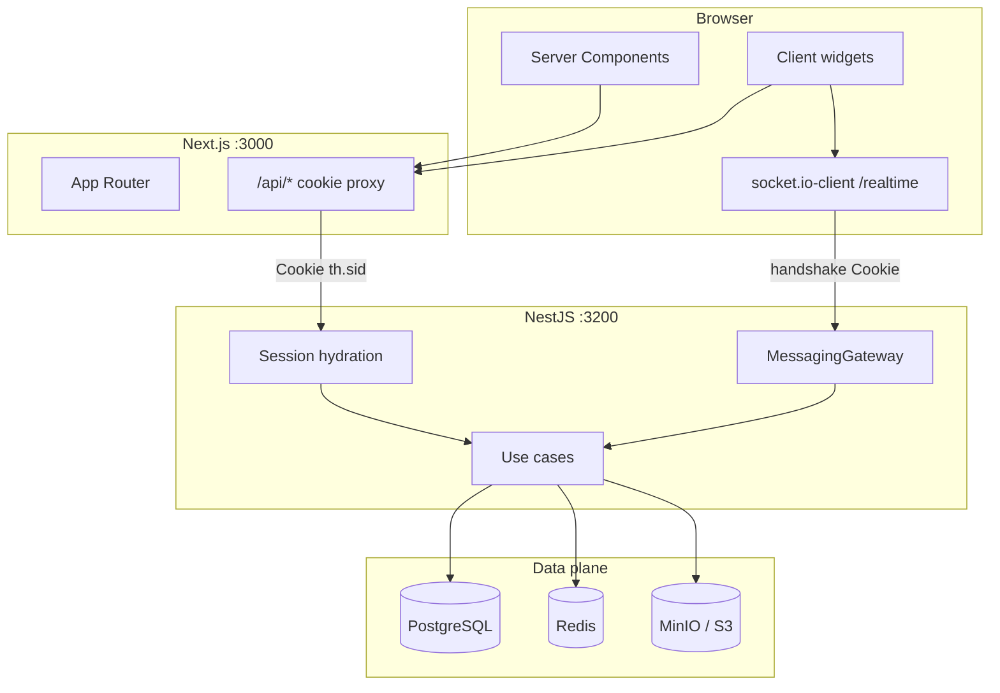

# TeamHub

> A full-stack collaboration platform with workspaces, feeds, notifications, role-based access control, and real-time messaging.

Monorepo: Next.js App Router (`apps/web`) and NestJS (`apps/api`). Nest is the security boundary. Next renders the UI and forwards the `th.sid` session cookie; it is not an auth server.

## Features

- Opaque session authentication (HttpOnly cookie, SHA-256 hashed tokens, Argon2 passwords)
- Workspaces, membership, invitations, and RBAC
- Feed: posts, comments, reactions
- Notifications with Redis cache-aside unread counts
- Workspace channels and DMs over HTTP and Socket.IO (`/realtime`)
- Presence, typing, and Redis message rate limits
- Socket.IO Redis adapter for multi-instance fan-out
- BullMQ invitation notification jobs
- Optimistic chat with `clientId` reconciliation and cursor pagination
- Workspace search, files (S3-compatible), Kanban-lite board, public guest demo

## Stack

**Frontend:** Next.js 16 App Router, React 19, TypeScript, TanStack Query 5, React Hook Form, Zod, Zustand, Socket.IO Client, TanStack Virtual, Tailwind CSS, Vitest. Server Components, SSR prefetch, Query hydration, optimistic updates, infinite/cursor queries.

**Backend:** NestJS 11, TypeScript, Drizzle ORM, postgres.js, Zod, Socket.IO, ioredis + node-redis, BullMQ, Argon2 (`@node-rs/argon2`), Pino, Vitest.

**Data and infrastructure:** PostgreSQL 17, Redis 7, MinIO (S3-compatible, local Compose). Staging-oriented Dockerfiles and Caddy config live in the repo; **nothing is deployed**.

**Testing:** API Vitest (unit, integration, e2e with SuperTest and Socket.IO client). Web Vitest.

## Architecture

Presentation (HTTP/Zod, Socket.IO gateway) → application use cases → domain ports (`Symbol` tokens) → Drizzle infrastructure. Auth (who is the actor) is separate from authorization (may they mutate this row).



## Repository layout

```text
apps/web    Next.js App Router (FSD-lite: entities, features, widgets, shared)
apps/api    NestJS modules, Drizzle schema and migrations, Vitest
deploy/     Caddyfile for a same-origin staging compose stack
.github/    CI workflow
```

## Prerequisites

- Node.js **22** (see `.nvmrc`) and npm **10.7** (`packageManager` in root `package.json`)
- Docker Compose (PostgreSQL, Redis, MinIO)

## Setup

```bash
git clone https://github.com/Frontendman25/team-hub.git
cd team-hub
npm ci
copy .env.example .env          # Windows
# cp .env.example .env          # macOS / Linux
copy apps\web\.env.example apps\web\.env.local
```

`.env.example` uses **fake local values only** (Postgres `teamhub` / `teamhub` on host port **5435**, Redis **6380**, MinIO keys `teamhub` / `teamhubminio`). Do not commit `.env`.

## Data plane, migrate, seed

```bash
npm run db:up
npm run db:migrate
npm run db:seed
```

`db:up` starts Postgres, Redis, and MinIO. Tests use a separate Postgres on **5436** (`docker-compose.test.yml`) and Redis DB **1** by default.

### Local demo accounts (development only)

`npm run db:seed` creates `demo_persona` users such as `sarah.chen@teamhub.local`. The shared local password is `DEMO_PASSWORD` in `apps/api/src/infrastructure/database/demo-users.ts`. **Local/e2e only.** Persona login is off when `NODE_ENV=production`. Never seed a production database. The login form does not prefill credentials.

## Development

```bash
npm run dev:api    # Nest http://localhost:3200
npm run dev:web    # Next http://localhost:3000
```

## Test, lint, type-check, build

```bash
npm test                          # API Vitest
npm run test:web                  # Web Vitest
npm run lint                      # API ESLint
npm run lint:web                  # Web ESLint
npm run type-check                # API tsc --noEmit
npm --prefix apps/web run type-check
npm run build:api
npm run build:web
```

API e2e expects Postgres at `TEST_POSTGRESQL_URL` (default `localhost:5436`) and Redis at `TEST_REDIS_URL` (default `localhost:6380/1`).

## Authentication and security

- Cookie `th.sid`: HttpOnly, SameSite=Lax, Path `/`, Secure when `COOKIE_SECURE` (defaults to production)
- Session token hashed (SHA-256) in `sessions`; passwords hashed with Argon2
- CSRF: mutating HTTP requires `Origin` matching `FRONTEND_URL` when the header is present
- Authorization in use cases (`WorkspaceAccess`, demo guest policy), not in React

## Realtime messaging

Postgres is the source of truth. Socket.IO namespace `/realtime` (Engine.IO path `/socket.io`) is a notification bus. Clients send `clientId` for idempotent inserts. Redis adapter fans out across API processes. BullMQ handles invitation notify jobs. Rate limits and presence use Redis (limiters fail-open if Redis errors after boot).

## Screenshots

Screenshots are not in this repository yet. Planned files:

| Surface | File |
| --- | --- |
| Workspace feed | `docs/images/workspace-feed.png` |
| Messenger | `docs/images/messenger.png` |
| Board | `docs/images/board.png` |

<!-- After adding the files above, replace this section with:


-->

## Status and limitations

- Independent full-stack product project under active development. Not currently production-deployed.
- No JWT, OAuth, or live WebRTC calls.
- Guest demo is a **shared** sandbox (TTL + cleanup), not a per-visitor clone.
- Staging Docker/Caddy config exists; cloud provisioning is out of scope.
- Auth throttle is in-memory per process.

License: MIT (see `package.json`).
